<a href="https://www.entcornell.com">
  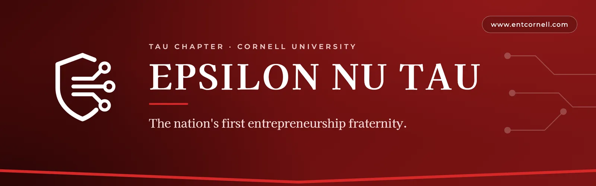
</a>

<p align="center">
  <a href="https://www.entcornell.com"></a>
  <a href="https://github.com/entcornell/ent-website/actions/workflows/ci.yml"></a>
  
</p>

<p align="center">
  
  
  
  
  
</p>

<p align="center">
  <a href="https://www.entcornell.com"><b>Live site</b></a> ·
  <a href="#-update-the-content"><b>Update the content</b></a> ·
  <a href="#-run-it-locally"><b>Run it locally</b></a> ·
  <a href="#-from-change-to-live"><b>Ship a change</b></a> ·
  <a href="CONTRIBUTING.md"><b>Contributing</b></a>
</p>

---

The official website of **Epsilon Nu Tau (ENT), Tau Chapter at Cornell University**: the
nation's first entrepreneurship fraternity and the largest student entrepreneurship
community on campus. It presents ENT to prospective members, partners and alumni: who we
are, our values, our members, the ventures they founded and the recruitment season.

> [!NOTE]
> **What this repo is not:** an application system or a member portal. Applications go
> through a Google Form, and there is no backend, database or login. Every word and photo
> on the site lives in this repository.

<table>
  <tr>
    <td width="76%">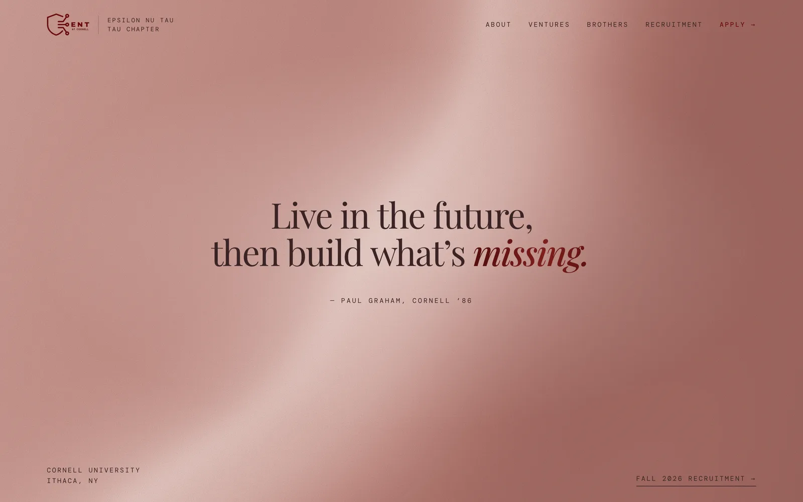</td>
    <td width="24%">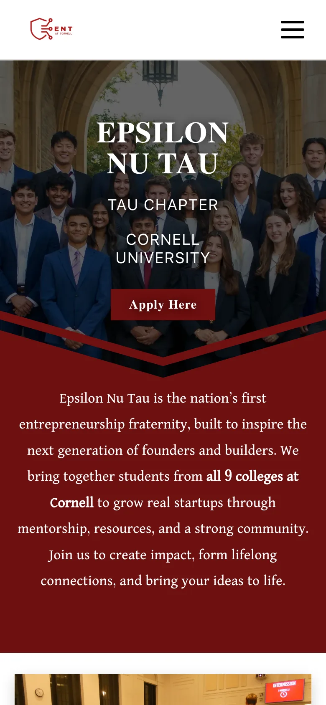</td>
  </tr>
  <tr>
    <td align="center"><sub>Home, desktop</sub></td>
    <td align="center"><sub>Home, phone</sub></td>
  </tr>
</table>

## Contents

- [At a glance](#-at-a-glance)
- [How it works](#-how-it-works)
- [Pages](#-pages)
- [Run it locally](#-run-it-locally)
- [Update the content](#-update-the-content)
- [Images](#-images)
- [Quality checks](#-quality-checks)
- [From change to live](#-from-change-to-live)
- [Project structure](#-project-structure)
- [Brand](#-brand)
- [Troubleshooting](#-troubleshooting)
- [Keeping this README current](#-keeping-this-readme-current)
- [Roadmap](#-roadmap)

## ◆ At a glance

|             |                                                                                        |
| ----------- | -------------------------------------------------------------------------------------- |
| **Live**    | [www.entcornell.com](https://www.entcornell.com) (`entcornell.com` redirects to `www`) |
| **Stack**   | React 19 · React Router 7 · Vite 8 · Font Awesome                                      |
| **Hosting** | Vercel, deployed from `main` on every merge; a preview URL for every pull request      |
| **Content** | Plain JavaScript data files in `src/components/`, no CMS                               |
| **Checks**  | oxlint · Prettier · Vitest (Testing Library) · knip, on every pull request             |
| **Images**  | WebP, resized by `npm run images`; 21 MB for the whole site                            |

## ◆ How it works

The site is static: Vite turns the React code, the content files and the photos into plain
HTML, CSS and JavaScript, and Vercel serves those files worldwide. React Router switches
pages in the browser, without reloading.

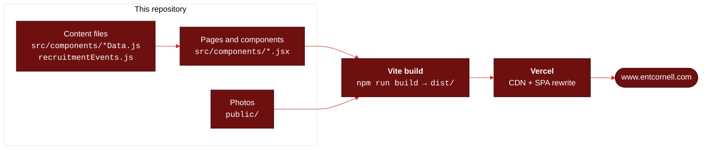

## ◆ Pages

| Route              | File                                       | What it shows                                                                        |
| ------------------ | ------------------------------------------ | ------------------------------------------------------------------------------------ |
| `/`                | `src/components/Home.jsx`                  | Hero, about blurb, ENT endeavors (popups), photo gallery                             |
| `/about`           | `src/components/About.jsx`                 | Our story and mission                                                                |
| `/Values`          | `src/components/Values.jsx`                | Brotherhood, authenticity, passion, mentoring                                        |
| `/studentVentures` | `src/components/StudentVentures.jsx`       | Member-founded businesses, filterable by category                                    |
| `/SBC`             | `src/components/SBC.jsx`                   | Small Business Collective, links to [sbc.entcornell.com](https://sbc.entcornell.com) |
| `/recruitment`     | `src/components/Recruitment.jsx`           | Recruitment timeline, application rounds and FAQ                                     |
| `/brothers`        | `src/components/Brothers.jsx`              | Executive board, members by pledge class, alumni                                     |
| `/newsletter`      | `src/components/Newsletter.jsx`            | Newsletter archive (hidden from the navbar, linked from the footer)                  |
| `/new`             | `src/components/founders/FoundersHome.jsx` | Redesign preview (work in progress): brothers and the ventures they built            |
| `/newsletter/:id`  | `src/components/NewsletterPage.jsx`        | One issue, with a full-screen reader                                                 |

`/members` redirects to `/brothers`. Every page shares the navbar, the footer and the
upcoming-event popup, wired in `src/App.jsx`.

<table>
  <tr>
    <td>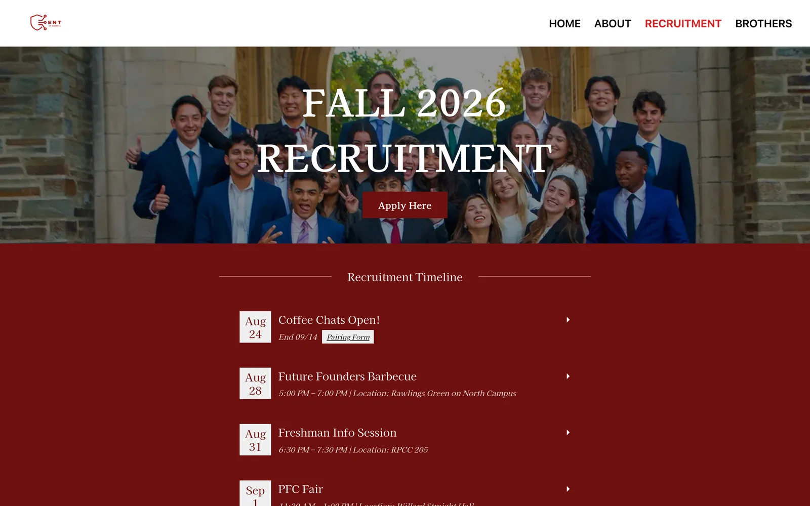</td>
    <td>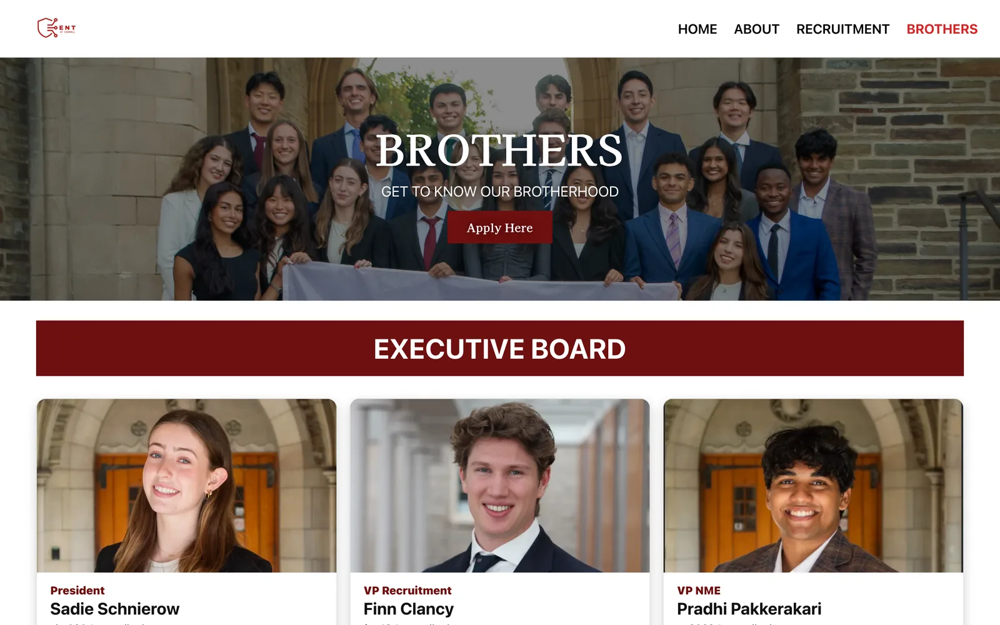</td>
    <td>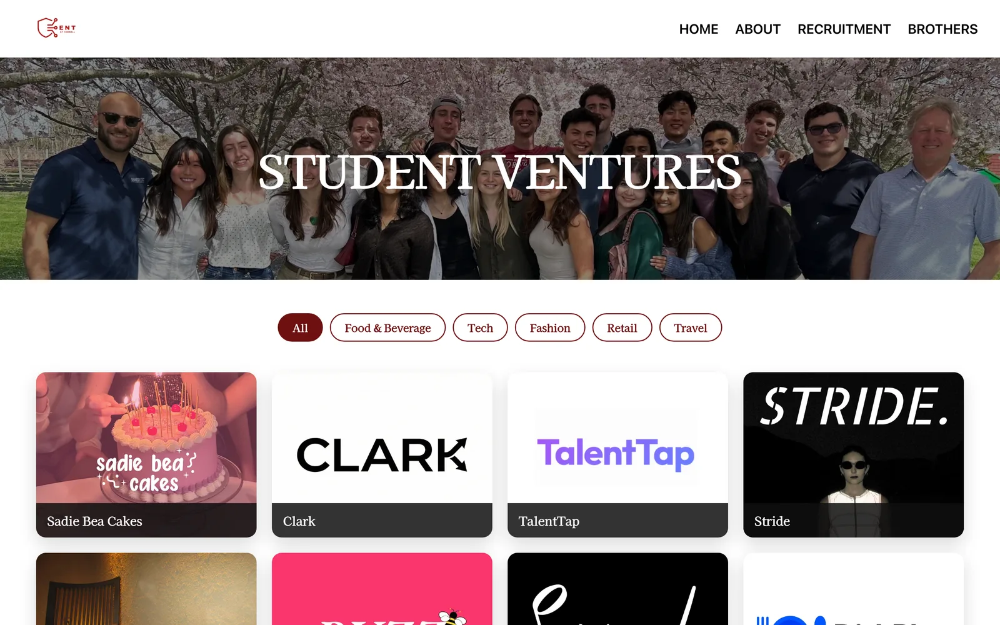</td>
  </tr>
  <tr>
    <td align="center"><sub>Recruitment</sub></td>
    <td align="center"><sub>Brothers</sub></td>
    <td align="center"><sub>Student Ventures</sub></td>
  </tr>
</table>

## ◆ Run it locally

You need [Node.js](https://nodejs.org) 24, pinned in `.nvmrc` (with
[nvm](https://github.com/nvm-sh/nvm), run `nvm use`).

```sh
git clone https://github.com/entcornell/ent-website.git
cd ent-website
npm ci                  # install the exact versions from package-lock.json
npm run hooks:install   # once per clone: enables the commit guard
npm run dev             # http://localhost:3000, reloads on save
```

| Command                 | What it does                                                                 |
| ----------------------- | ---------------------------------------------------------------------------- |
| `npm run dev`           | Development server with hot reload on port 3000                              |
| `npm run build`         | Production build into `dist/`                                                |
| `npm run preview`       | Serves the production build locally                                          |
| `npm test`              | Runs the tests once (`npm run test:watch` re-runs them on save)              |
| `npm run check`         | Everything CI checks: lint, format, tests and dead code                      |
| `npm run lint`          | oxlint; warnings fail too                                                    |
| `npm run format`        | Formats every file with Prettier (`npm run format:check` only checks)        |
| `npm run deadcode`      | knip: unused files, exports and dependencies                                 |
| `npm run images`        | Resizes photos and converts them to WebP ([Images](#-images))                |
| `npm run readme:assets` | Regenerates the banner and screenshots in this README                        |
| `npm run hooks:install` | Enables the commit guard (blocks `.env` files, build output, AI attribution) |

## ◆ Update the content

Almost every update is a change to **one data file**. You never need to touch page layout
to add a member, an event or a venture.

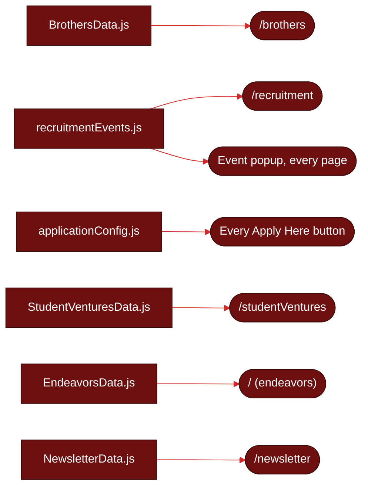

| To change…                    | Edit                                    | Notes                                                                                       |
| ----------------------------- | --------------------------------------- | ------------------------------------------------------------------------------------------- |
| Members, e-board, alumni      | `src/components/BrothersData.js`        | Arrays `eboard`, `brotherhood` (one entry per pledge class) and `alumni`                    |
| Recruitment events and rounds | `src/components/recruitmentEvents.js`   | `recruitmentEvents`, `applicationRounds` and `RECRUITMENT_YEAR`; also feeds the event popup |
| Application form link         | `src/components/applicationConfig.js`   | Used by every "Apply Here" button, including Round One                                      |
| Student ventures              | `src/components/StudentVenturesData.js` | The filter bar's categories come from each venture's `category`                             |
| Home page endeavors           | `src/components/EndeavorsData.js`       | Cards and popups on the home page                                                           |
| Newsletter issues             | `src/components/NewsletterData.js`      | Newest issue first; pages in `public/newsletters/issueN/`                                   |

<details>
<summary><b>Add a member</b></summary>

1. Put their headshot in `public/headshots-fall2026/` and shrink it:

   ```sh
   npm run images -- public/headshots-fall2026/FirstLast-Headshot.jpg
   ```

2. Add an entry to the right pledge class in `src/components/BrothersData.js`:

   ```js
   {
     name: "First Last",
     email: "netid@cornell.edu",
     year: "2029",
     major: "Computer Science",
     involvement: "Clubs, teams",
     hobbies: "Hobbies",
     image: "/headshots-fall2026/FirstLast-Headshot.webp",
     style: { objectPosition: "center 30%" }, // optional: moves the crop up or down
   },
   ```

   E-board entries also take a `role`, for example `"VP Recruitment"`.

3. Run `npm run dev` and check the card on `/brothers`. `npm test` fails if the image path
   doesn't match a file in `public/`.

</details>

<details>
<summary><b>Start a new recruitment season</b></summary>

1. In `src/components/recruitmentEvents.js`, set `RECRUITMENT_YEAR` and replace
   `recruitmentEvents` and `applicationRounds`. Write dates like `"Sep 9"`; a test checks
   that every date can be read.
2. Update the application link in `src/components/applicationConfig.js`.
3. Update the season title (`FALL 2026`) at the top of `src/components/Recruitment.jsx`.

The popup on every page shows the **next event that hasn't happened yet**, once per visit,
after 10 seconds or about a third of the way down the page. When every event is in the
past it stays hidden, so an old season never advertises itself.

</details>

<details>
<summary><b>Add a student venture</b></summary>

1. Add its logo or photo to `public/studentbusinesses/` and run `npm run images` on it.
2. Add an entry to `src/components/StudentVenturesData.js`:

   ```js
   {
     title: "Venture Name",
     desc: "One or two sentences on what it does.",
     img: "/studentbusinesses/VentureName.webp",
     link: "https://venture.com",
     founder: "First Last",
     category: "Tech", // a new category adds a new filter button
   },
   ```

</details>

<details>
<summary><b>Publish a newsletter issue</b></summary>

1. Export the issue's pages as images into `public/newsletters/issueN/` (`1.png`, `2.png`,
   …) with a headline image, and run `npm run images -- public/newsletters/issueN/*`.
2. Add the issue **at the top** of `issues` in `src/components/NewsletterData.js`, with the
   next `id`, `title`, `date`, `author`, `excerpt`, `image`, `pages` and `sources`.

</details>

## ◆ Images

Phone photos are 3–15 MB each and make the site crawl on mobile data. Every photo goes
through `npm run images` before it is committed.

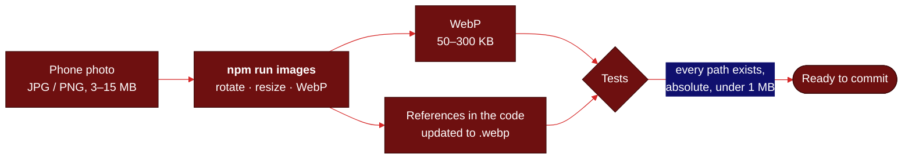

| Folder                                                            | Contents                                    | Resized to   |
| ----------------------------------------------------------------- | ------------------------------------------- | ------------ |
| `public/images/`                                                  | Page heroes, backgrounds and gallery photos | 2000 px wide |
| `public/headshots-fall2026/`, `headshots-fall2025/`, `headshots/` | Member headshots by season                  | 800 px       |
| `public/group-pics/`                                              | Group photos                                | 2000 px      |
| `public/studentbusinesses/`                                       | Student venture logos and photos            | 1200 px      |
| `public/endeavors/`                                               | Home page endeavor images                   | 1200 px      |
| `public/newsletters/issueN/`                                      | Newsletter pages and headline image         | 1600 px      |

- Everything in `public/` is served as-is: `public/images/home1.webp` is
  `/images/home1.webp`. **Always write paths with a leading `/`**; without it an image
  breaks on nested pages like `/newsletter/3`.
- The script keeps the phone's rotation, deletes the original (git history keeps it) and
  updates every reference in the code.
- Logos and icons (`ENTTransparentLogo.png`, `favicon.ico`, `apple-touch-icon.png`,
  `ENTLogo*.png`) stay PNG on purpose: some apps' link previews don't read WebP.
- Name files `FirstLast-Headshot.jpg`, without spaces. When you replace a photo, delete the
  old one.

## ◆ Quality checks

Every pull request runs `.github/workflows/ci.yml`. Each check reports even if another one
fails, so one run shows every problem.

| Check     | Tool                                           | Catches                                                              |
| --------- | ---------------------------------------------- | -------------------------------------------------------------------- |
| Lint      | [oxlint](https://oxc.rs)                       | Bugs, React hook mistakes, accessibility problems; warnings fail too |
| Format    | [Prettier](https://prettier.io)                | Inconsistent formatting (`npm run format` fixes it)                  |
| Tests     | [Vitest](https://vitest.dev) + Testing Library | Broken pages and content mistakes (below)                            |
| Dead code | [knip](https://knip.dev)                       | Unused files, exports and dependencies                               |
| Build     | [Vite](https://vite.dev)                       | Anything that would break the production build                       |

What the tests protect:

- **Every route renders** its page, and `/members` still redirects to `/brothers`.
- **The recruitment timeline** opens and closes with the mouse and the keyboard.
- **The event popup** picks the right next event, and every timeline date is readable.
- **Every image path** in the code points to a file that exists and uses a leading `/`, and
  no image in `public/` is over 1 MB.
- **This README** lists every route, content file, npm script and screenshot
  ([below](#-keeping-this-readme-current)).

Locally, `git commit` runs the commit guard (`.githooks/`, `scripts/git-guard.mjs`), which
blocks `.env` files, build output and AI attribution trailers.

## ◆ From change to live

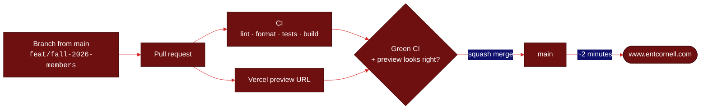

1. Create a branch from `main`: `git switch -c feat/fall-2026-members`.
2. Make the change and look at it with `npm run dev`.
3. Run `npm run check` and `npm run build`.
4. Push and open a pull request. Wait for CI, open the **Vercel preview** linked on the PR,
   and check the pages you changed.
5. **Squash merge.** `main` is production: the merge publishes the site.

`vercel.json` tells Vercel to build with `npm run build` into `dist/` and to send every route
to `index.html`, so links like `/brothers` work when opened directly (real files in
`public/` are served first). The full workflow and commit format are in
[CONTRIBUTING.md](CONTRIBUTING.md).

## ◆ Project structure

```
ent-website/
├── index.html              Page title, description and link-preview (Open Graph) tags
├── public/                 Static files served as-is: favicon, logos, photos
├── src/
│   ├── index.jsx           Entry point, mounts <App />
│   ├── App.jsx             Routes and the shared layout (navbar, footer, event popup)
│   ├── index.css           Global styles
│   ├── components/         One .jsx per page or component, each with its own .css;
│   │                       the *Data.js content files; their *.test.* files
│   ├── content.test.js     Image paths and sizes
│   ├── readme.test.js      This README stays in sync with the code
│   └── test/setup.js       Test setup (Vitest + Testing Library)
├── scripts/
│   ├── optimize-images.mjs npm run images
│   ├── readme-assets.mjs   npm run readme:assets
│   └── git-guard.mjs       The commit guard behind .githooks/
├── docs/
│   ├── decisions/          Why the project is set up the way it is
│   └── readme/             Banner (banner.html is its source) and screenshots
├── .github/                CI workflow, PR and issue templates
├── vite.config.js          Build and test config
└── vercel.json             Hosting config
```

## ◆ Brand

The site's own palette and type: the reference for this README and for any redesign.

|                                                                                          | Color      | Hex       | Used for                                                |
| ---------------------------------------------------------------------------------------- | ---------- | --------- | ------------------------------------------------------- |
|  | ENT maroon | `#6E1010` | Primary: section backgrounds, buttons, the hero chevron |
|  | Signal red | `#D62828` | Accents, active links, hover states                     |
|  | Deep red   | `#A91C1C` | Secondary accents                                       |
|  | Ink        | `#111111` | Body text                                               |
|  | Paper      | `#F7F7F7` | Light surfaces                                          |

**Type:** serif throughout, from
[Kaisei Decol](https://fonts.google.com/specimen/Kaisei+Decol),
[Kaisei Opti](https://fonts.google.com/specimen/Kaisei+Opti) and
[Dai Banna SIL](https://fonts.google.com/specimen/Dai+Banna+SIL), with
[Montserrat](https://fonts.google.com/specimen/Montserrat) for labels and member cards.
**Logo:** `public/ENTTransparentLogo.png`, a shield whose edge becomes three circuit lines.

## ◆ Troubleshooting

<details>
<summary><b><code>npm test</code> says an image is missing</b></summary>

The path in the code doesn't match a file in `public/`. Check the spelling, the extension
(`.webp` after `npm run images`) and the leading `/`. The test output lists each broken
path and the file it is written in.

</details>

<details>
<summary><b>CI fails on "Format"</b></summary>

Run `npm run format`, commit the result and push again.

</details>

<details>
<summary><b>The event popup doesn't show up</b></summary>

It shows once per browser session, and only while a future event exists in
`recruitmentEvents.js`. Open the site in a private window to see it again; if the season is
over, that is expected.

</details>

<details>
<summary><b>A page works on the preview but 404s when opened directly</b></summary>

The SPA rewrite in `vercel.json` handles that; check it is still there and that the route is
declared in `src/App.jsx`.

</details>

## ◆ Keeping this README current

The README is part of the code: **a pull request that changes how the site works updates the
README in the same PR**.

- `src/readme.test.js` fails CI when a route, content file, npm script or screenshot exists in
  the code but not here (or a screenshot linked here no longer exists).
- After a visual change, run `npm run readme:assets` to regenerate the banner and screenshots
  in `docs/readme/`, and commit them.
- The PR template asks for it, and `CHANGELOG.md` records every notable change.

## ◆ Roadmap

- [x] Move off Create React App to Vite, with lint, tests and CI on every pull request.
- [x] Make the recruitment dropdowns, venture cards and About menu keyboard-accessible.
- [x] Compress every image (358 MB → 21 MB) and use absolute image paths.
- [ ] Convert the code to TypeScript.
- [ ] Give each page its own `<title>`, description and link-preview image.
- [ ] Redesign: a stronger visual identity for ENT, with motion.

---

<p align="center">
  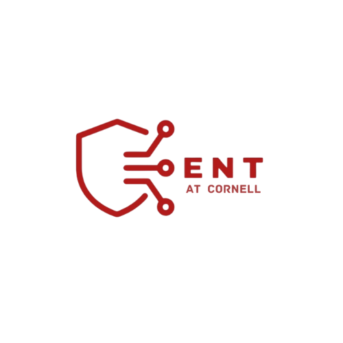<br />
  <sub>© Epsilon Nu Tau, Tau Chapter at Cornell University. All rights reserved.</sub><br />
  <sub><a href="https://www.instagram.com/entcornell">Instagram</a> · <a href="https://www.linkedin.com/company/epsilon-nu-tau">LinkedIn</a> · <a href="mailto:ent.cornell@gmail.com">ent.cornell@gmail.com</a></sub>
</p>
